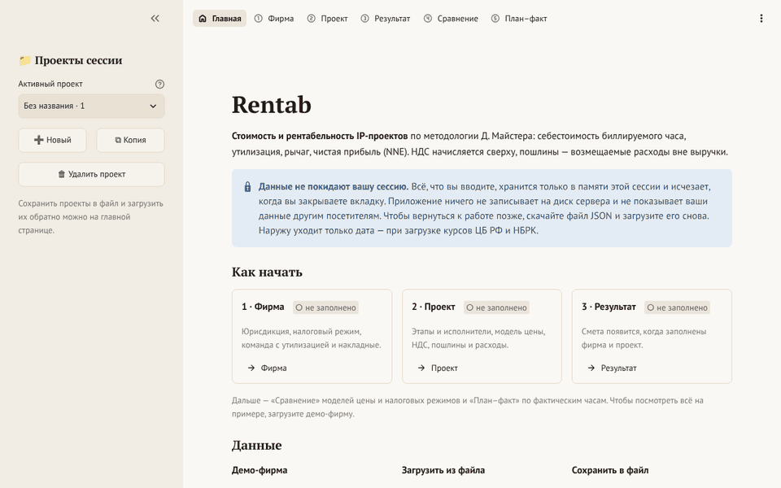
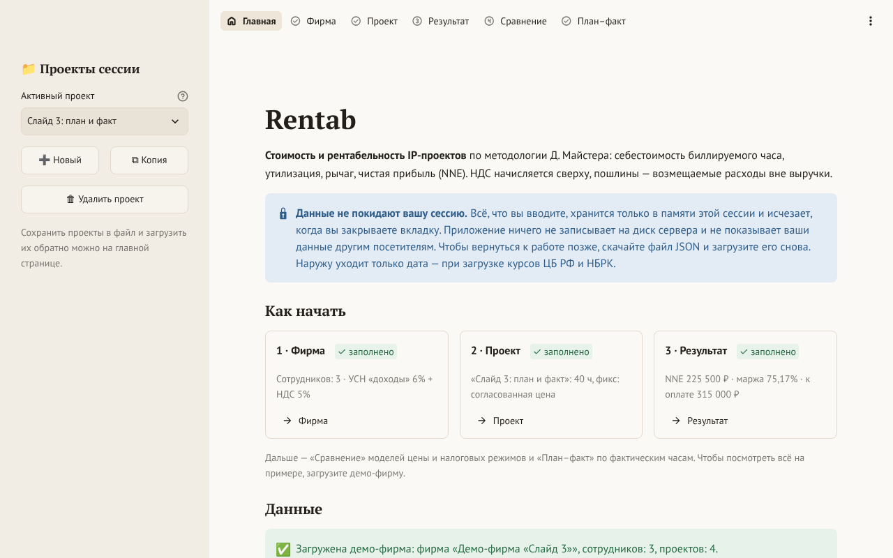
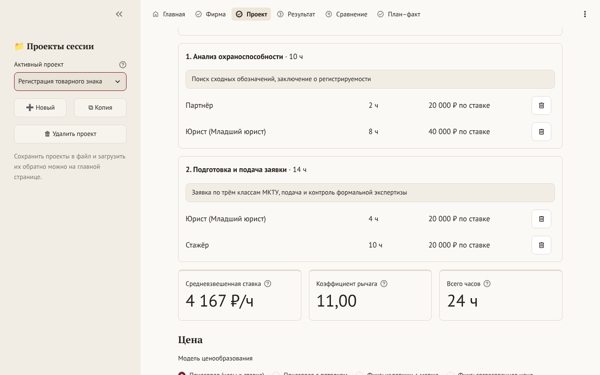
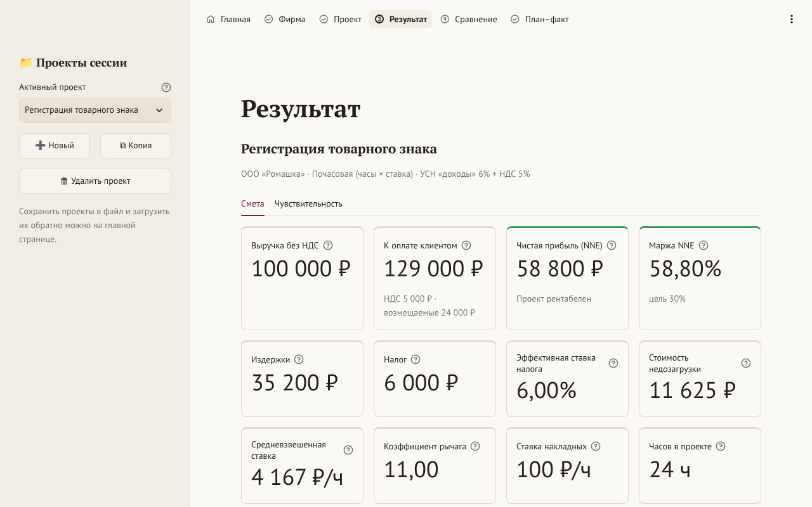
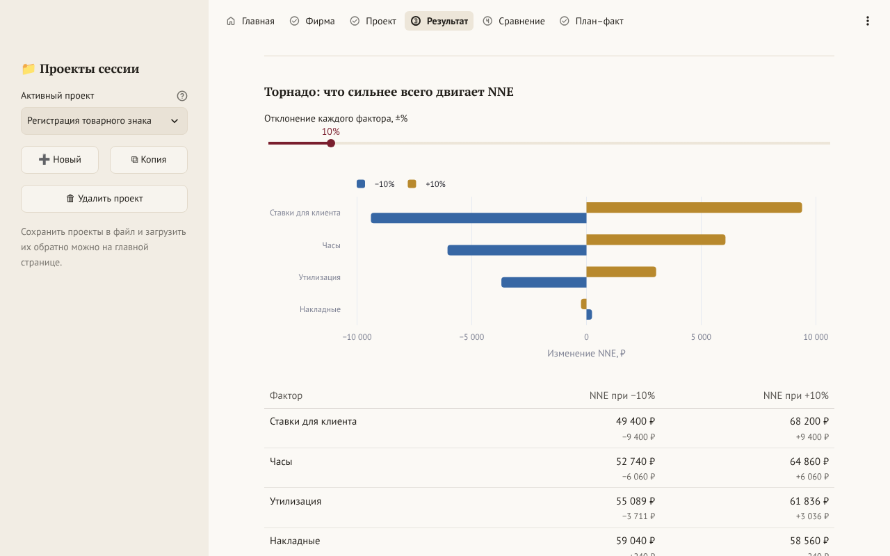
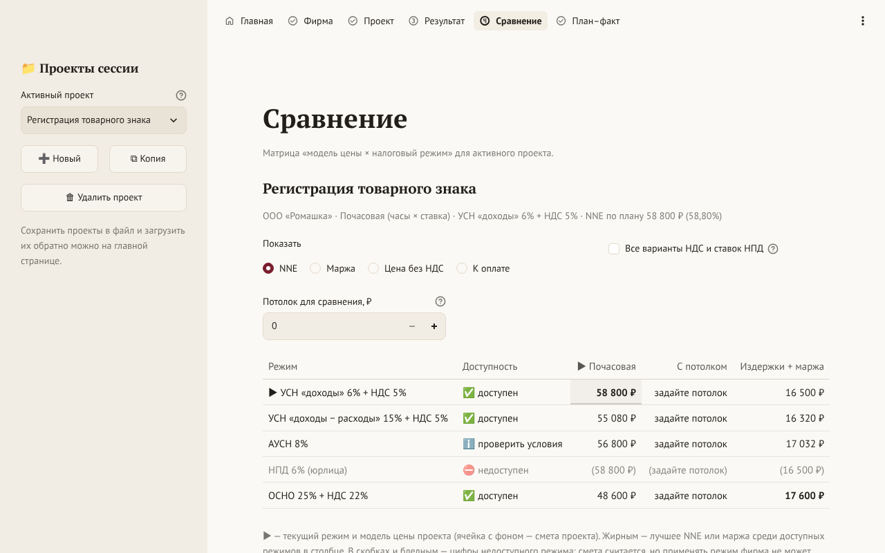
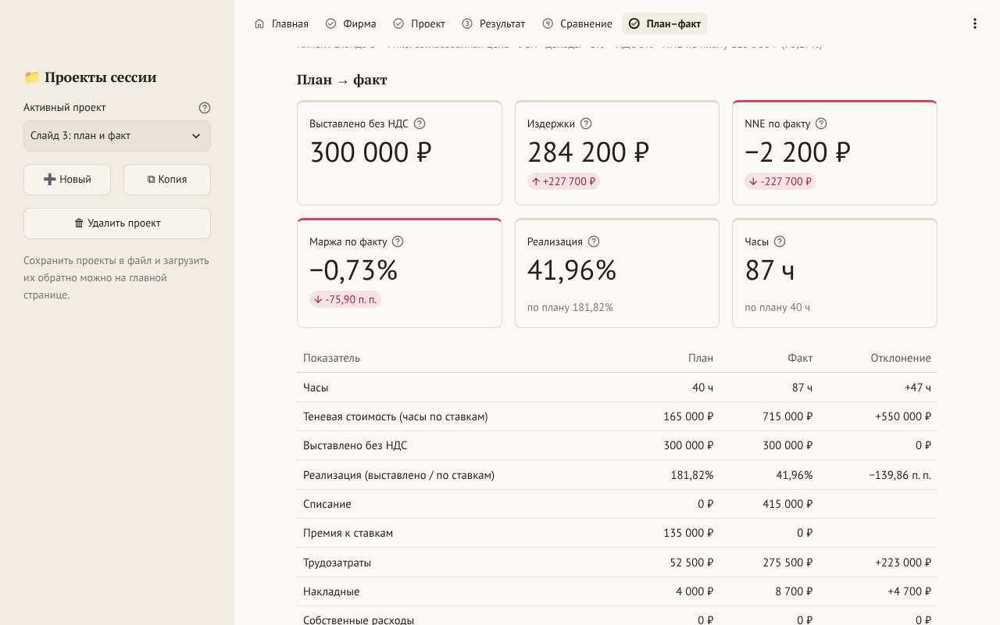

# Rentab

[](https://github.com/mystuff4git/rentab/actions/workflows/ci.yml)
[](LICENSE)
[](pyproject.toml)
[](https://rentab.streamlit.app/)

Калькулятор стоимости и рентабельности проектов IP-юридического консалтинга
(Россия и Казахстан). Показывает, сколько фирме на самом деле стоит час
юриста, какую цену назвать клиенту и сколько проект заработает после
накладных и налогов. В основе — методология Д. Майстера («Управление фирмой,
оказывающей профессиональные услуги»): себестоимость биллируемого часа,
утилизация, рычаг (leverage), реализация и чистая прибыль проекта (NNE).
Маржа считается от выручки за услуги; НДС начисляется сверху; патентные
пошлины — транзит, а не доход фирмы.

Наследник магистерской ВКР (НИУ ВШЭ, «ЛигалТех», v0.3): расчётное ядро
переписано, исправлены ошибки методологии, ставки 2026 года сверены с
первоисточниками.



**Демо:** https://rentab.streamlit.app/ · *English summary is [below](#english).*

## Что умеет

- **Себестоимость часа с учётом утилизации:** оклад и взносы работодателя по
  ставкам 2026 года (или нормативное вознаграждение партнёра) делятся на
  биллируемые часы; накладные — на биллируемую ёмкость команды.
- **Три модели цены:** почасовая, почасовая с потолком, фикс «издержки +
  маржа» по закрытым формулам (и согласованная фикс-цена).
- **Налоговые режимы РФ и РК:** УСН (6% и 15% с минимальным налогом), АУСН,
  НПД, ОСНО, ОУР РК; НДС сверху или «включая НДС»; проверка применимости
  режима по данным фирмы.
- **Этапы со светофором:** несколько исполнителей на этапе, выручка этапа —
  по теневой стоимости (ставка × часы), маржа этапа — после налога.
- **Пошлины Роспатента и Казпатента** по каталогам (классы МКТУ, пункты
  формулы, категория заявителя) — отдельной строкой «возмещаемые расходы».
- **Аналитика:** запас часов до нулевой прибыли, торнадо ±X%, ползунки «что
  если», план–факт (реализация, списания, перерасход по этапам и ролям),
  сравнение «модель цены × налоговый режим» на одном экране.
- **Документы:** коммерческое предложение в PDF и DOCX с логотипом и
  реквизитами (шрифты встроены, суммы до копейки) и смета XLSX с живыми
  формулами Excel — [примеры](docs/examples/).
- **Приватность:** данные фирмы не хранятся на сервере — только в памяти
  сессии; сохранить работу — скачать файл JSON и загрузить его снова.

## Скриншоты

<table>
  <tr>
    <td width="50%"><a href="docs/screenshots/v1.0/01_home_demo.png"></a><br><sub>Главная: дисклеймер, «Как начать», демо-фирма</sub></td>
    <td width="50%"><a href="docs/screenshots/v1.0/03_project.png"></a><br><sub>Проект: этапы, исполнители, ставка и рычаг</sub></td>
  </tr>
  <tr>
    <td><a href="docs/screenshots/v1.0/04_result_estimate.png"></a><br><sub>Смета: KPI с подсказками-формулами</sub></td>
    <td><a href="docs/screenshots/v1.0/05_sensitivity.png"></a><br><sub>Чувствительность: что сильнее всего двигает NNE</sub></td>
  </tr>
  <tr>
    <td><a href="docs/screenshots/v1.0/06_compare.png"></a><br><sub>Сравнение «модель цены × налоговый режим»</sub></td>
    <td><a href="docs/screenshots/v1.0/07_plan_fact.png"></a><br><sub>План–факт: «партнёр тянет проект», NNE 225 500 → −2 200 ₽</sub></td>
  </tr>
</table>

Ещё: [команда фирмы](docs/screenshots/v1.0/02_firm_team.png),
[тёмная тема](docs/screenshots/v1.0/08_result_dark.png),
[узкий экран](docs/screenshots/v1.0/09_result_narrow.png), все экраны по
фазам — [`docs/screenshots/`](docs/screenshots/).

## Быстрый старт

**Онлайн:** https://rentab.streamlit.app/ — нажмите «Загрузить демо-фирму» на
главной. Для данных реальной фирмы лучше запустить Rentab у себя (см.
«Приватность»).

**Локально через [uv](https://docs.astral.sh/uv/)** (Python 3.11–3.13):

```bash
git clone https://github.com/mystuff4git/rentab.git
cd rentab
uv run streamlit run app/Home.py      # http://localhost:8501
```

**В Docker:**

```bash
docker compose up --build             # http://localhost:8501
```

или без compose, с теми же ограничениями:

```bash
docker build -t rentab .
docker run --rm -p 127.0.0.1:8501:8501 --read-only --tmpfs /tmp:size=64m,mode=1777 \
  --cap-drop ALL --security-opt no-new-privileges rentab
```

Контейнер работает от непривилегированного пользователя с файловой системой
только для чтения: писать приложению некуда, кроме временного `/tmp` в
памяти. Порт открыт только на этом компьютере.

**Как библиотека.** Расчётное ядро `rentab_core` — чистый Python-пакет без
интерфейса:

```python
from rentab_core import calculate_estimate, dashboard
from rentab_core.demo import demo_workspace
from rentab_core.formatting import money, pct_label

workspace = demo_workspace()
record = workspace.projects[1]  # «Регистрация товарного знака»
estimate = calculate_estimate(record.scenario(workspace.firm))
print(money(estimate.nne, "₽"), pct_label(estimate.margin))  # 58 800 ₽ 58,80%
print(dashboard(estimate).profitability)  # profitable
```

## Методология

Формулы, обозначения и разобранные примеры (почасовая модель, фикс-цена на
обеих базах налога, слайд 3 защиты ВКР) — [`docs/methodology.md`](docs/methodology.md).
Это источник истины: код и тесты следуют ему. Коротко и упрощённо (полностью —
[раздел 1](docs/methodology.md#1-формулы-на-одном-экране)):

```
Себестоимость часа      c_i = W_i / (H_i × u_i)          W — оклад + взносы, H — контрактные часы, u — утилизация
Ставка накладных        ρ = Σ OH / Σ_i H_i × u_i         на биллируемую ёмкость всей команды
Издержки проекта        C = Σ_a c_i(a)·h_a + ρ·Σ_a h_a + Own

Выручка и оплата        R — выручка за услуги без НДС;  VAT = v × R;  к оплате = R + VAT + D
                        D — пошлины и другие возмещаемые расходы: транзит, вне R
Налог                   «доходы»:            Tax = t × R  (УСН — минус взносы, не больше 50%)
                        «доходы − расходы»:  Tax = max(t × (R − C), t_min × R)
Результат               NNE = R − C − Tax;   m = NNE / R

Фикс «издержки + маржа» «доходы»:            P = C / (1 − t − m*)
                        «доходы − расходы»:  P = C × (1 − t) / (1 − t − m*)
Этапы                   R_s = R × V_s / Σ V,  V_s = Σ ставка × часы (теневая стоимость)
```

Что и почему изменилось по сравнению с v0.3 — [`docs/legacy_audit.md`](docs/legacy_audit.md)
и [`docs/phase2_before_after.md`](docs/phase2_before_after.md). Golden-сценарий
слайда 3 (NNE 225 500 ₽ по плану и −2 200 ₽ по факту) проверяется тестами.

## Приватность

- Всё, что вы вводите, хранится в памяти вашей сессии на сервере и исчезает,
  когда вы закрываете вкладку. Приложение ничего не пишет на диск сервера и не
  показывает ваши данные другим посетителям. Это проверяют тесты с аудит-хуком
  записи на диск и запуск в контейнере только для чтения
  ([ADR 0006](docs/adr/0006-phase4-privacy-and-data.md),
  [ADR 0010](docs/adr/0010-phase8-release.md)).
- Сохранить работу — скачать файл JSON (фирма, курсы, проекты) и загрузить его
  снова. Формат — [`docs/profile_format.md`](docs/profile_format.md).
- Наружу уходит только дата — когда вы загружаете курсы ЦБ РФ и НБРК.
- **Публичное демо** работает на Streamlit Community Cloud (Snowflake), за
  пределами России и Казахстана. Само приложение обращается только к себе и в
  анонимную статистику Streamlit, которую Cloud включает поверх настроек
  приложения (по описанию Streamlit — без введённых значений). Страница Cloud
  вокруг приложения подключает свою веб-аналитику: Google Analytics, Google Tag
  Manager, Heap, Segment. Главная демо об этом предупреждает; проверка —
  [`cloud_check.js`](docs/screenshots/v1.0/cloud_check.js). Для данных реальной
  фирмы (оклады сотрудников — персональные данные) запускайте Rentab у себя
  через uv или Docker: там нет ни статистики, ни сторонней аналитики.

## Ограничения и дисклеймер

**Rentab — инструмент оценки, а не налоговая или юридическая консультация.**

- **Ставки и пошлины.** Ставки, пороги и пошлины 2026 года собраны по
  первоисточникам, но у 33 из 82 записей реестра средняя или низкая
  уверенность (`needs_review: true`): полные тексты норм при разработке были
  недоступны, значения сверены по выдержкам. Пошлины, размер которых не
  найден, считаются нулём и в смету не попадают. Источник и уверенность каждой
  записи — [`docs/rates_verification.md`](docs/rates_verification.md).
- **«Нужна проверка юристом»** — 8 записей: значение верное, но применимость
  зависит от обстоятельств фирмы.
- **Налог проекта — аппроксимация:** это доля годового налога фирмы,
  отнесённая на проект ([methodology.md, раздел 5.2](docs/methodology.md#52-налог-проекта--аппроксимация)).
  Убыток проекта не уменьшает налог по другим проектам, минимальный налог
  сравнивается по проекту, а не по году.
- Перед отправкой КП клиенту сверьте ставки, пошлины и курсы.

Известные ограничения версии 1.0 (полный список —
[ROADMAP](docs/ROADMAP.md#отложено-и-известные-ограничения)):

- план–факт учитывает фактические часы и выставленную сумму, но не
  фактические собственные расходы;
- данные живут до закрытия вкладки, смета в файл не входит — её пересчитывают;
- курс тенге по умолчанию — индикативный, точные курсы загружаются кнопкой;
- значения формул XLSX видны в программах с движком формул (Excel,
  LibreOffice, Google Таблицы); Google Docs не читает встроенные в DOCX шрифты;
- кнопка «Upload» и меню настроек — на английском: это элементы Streamlit.

### Что требует проверки

Открытые вопросы из [ROADMAP](docs/ROADMAP.md#открытые-вопросы):

- **Сверка с полными текстами норм:** тариф взносов МСП и входит ли
  деятельность в области права (ОКВЭД 69.10) в перечень № 4125-р; предел базы
  ООСМС и ВОСМС на 2026 год; статья НК РК со ставкой КПН; минимальная база
  соцналога; суммы большинства пошлин Роспатента (редакция № 1459) и колонки
  прейскуранта Казпатента; курсы ЦБ РФ и НБРК вживую.
- **К юристу:** региональные ставки УСН, участие региона в АУСН, класс
  профессионального риска по ОКВЭД, база СО и соцналога РК.

Если вы знаете ответ — откройте issue или PR со ссылкой на первоисточник.
Ставки живут только в `src/rentab_core/rates/*.yaml` и
`src/rentab_core/duties/data/*.yaml`; запись без источника не может быть
помечена сверенной — это проверяет схема.

## Для разработчиков

```bash
uv sync                           # окружение по uv.lock (группы dev, legacy, app)
uv run streamlit run app/Home.py  # приложение
uv run pytest                     # тесты и покрытие ядра (порог 90%)
uv run ruff check && uv run ruff format --check && uv run mypy
```

Структура:

```
src/rentab_core/   расчётное ядро без UI: модели, налоги, ценообразование, аналитика,
                   реестр ставок, файл профиля JSON, документы (КП в PDF и DOCX, смета XLSX)
app/               интерфейс на Streamlit; только вызывает ядро и рисует
tests/             core/ — ядро и golden-сценарии, characterization/ — поведение v0.3
                   и мост «было/стало», app/ — интерфейс, приватность, деплой
legacy/rentab_v03/ замороженная копия v0.3 — эталон для сравнения
docs/              методология, сверка ставок, ROADMAP, ADR, аудит v0.3, примеры, скриншоты
```

Документы: [методология](docs/methodology.md) ·
[сверка ставок](docs/rates_verification.md) · [ROADMAP](docs/ROADMAP.md) ·
[решения (ADR)](docs/adr/) · [формат файла профиля](docs/profile_format.md) ·
[аудит v0.3](docs/legacy_audit.md) · [CHANGELOG](CHANGELOG.md) ·
[правила для разработки](CLAUDE.md).

## English

Rentab is an open-source cost and profitability calculator for IP legal
consulting projects in Russia and Kazakhstan, based on David Maister's
professional services firm methodology: billable-hour cost with utilization,
leverage, realization and net-net earnings (NNE). Margins are measured on
service revenue; VAT is charged on top; patent office fees are pass-through
disbursements, not firm revenue.

- **Features:** hourly, capped and fixed-fee pricing (closed-form
  cost-plus-margin); Russian and Kazakh tax regimes for 2026 with an
  eligibility check; stage-level traffic lights; Rospatent and Kazpatent fee
  catalogs; break-even hours, tornado chart and what-if sliders; plan vs.
  actual; pricing model × tax regime comparison; client proposals in PDF and
  DOCX with embedded fonts and an XLSX estimate with live Excel formulas.
- **Try it:** https://rentab.streamlit.app/ (click «Загрузить демо-фирму»), or
  run it locally: `uv run streamlit run app/Home.py` or `docker compose up --build`.
- **Privacy:** firm data lives only in the session memory; nothing is written
  to the server's disk (checked by tests with a write audit hook and a
  read-only container). Save your work as a JSON file. The public demo runs on
  Streamlit Community Cloud, which enables Streamlit's anonymous usage
  statistics, and its page around the app loads web analytics (Google
  Analytics, Heap, Segment); run Rentab yourself for real firm data.
- **Disclaimer:** an estimation tool, not tax or legal advice. 33 of 82 rate
  and fee records are marked `needs_review`, 8 need a lawyer's check for the
  firm's circumstances; project-level tax is an allocation of the firm's
  annual tax. See [`docs/rates_verification.md`](docs/rates_verification.md).
- The UI and documentation are in Russian; formulas are in
  [`docs/methodology.md`](docs/methodology.md).

## Лицензия

Код — [MIT](LICENSE) © 2026 Yaroslav Statsurin. Шрифты PT Sans, PT Serif и
PT Mono (ParaType) — SIL Open Font License 1.1, файлы лицензий лежат рядом со
шрифтами в `app/static/fonts` и `src/rentab_core/export/fonts`.
